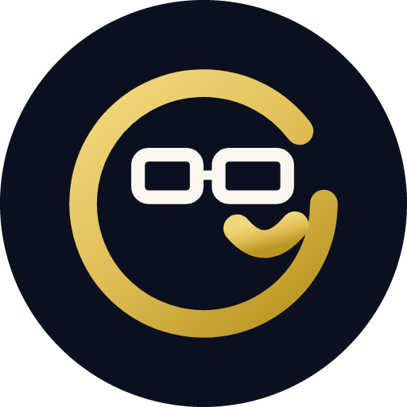
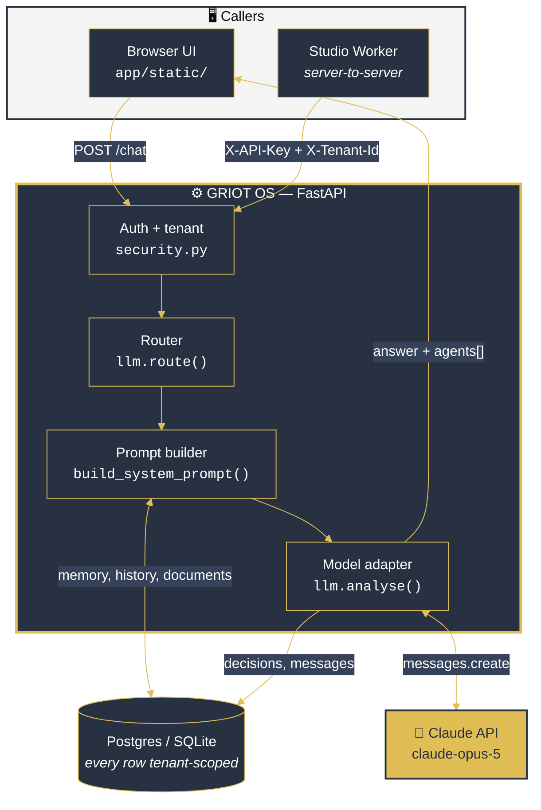
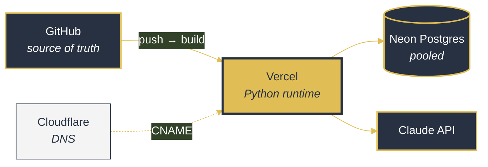

<div align="center">


# GRIOT OS

**Strategic intelligence &amp; execution agent**

*Think like a strategist. Validate like a data scientist. Build like a software engineer.*<br/>
*Communicate like a storyteller. Operate like an owner.*

<br/>


<br/>


**A product of SpeakPower**

</div>

---

## The marks

GRIOT carries two marks with two different jobs. They are never used in the same role.

<table>
<tr>
<td width="50%" align="center">
<br/><br/>
<strong>The GRIOT Signature</strong><br/>
<sub>THE BRAND MARK</sub>
</td>
<td width="50%" align="center">
<br/><br/>
<strong>The G</strong><br/>
<sub>THE AGENT'S FACE</sub>
</td>
</tr>
<tr>
<td valign="top">
Introduces GRIOT. It is the only mark used for branding — the browser tab, the
app icons, the sidebar, the social card, decks and merchandise.
<br/><br/>
At tab sizes the medallion is cropped past its decorative band so the face
survives the downscale, with the gold rim keeping its circular silhouette. Same
mark, drawn for the size it is used at.
</td>
<td valign="top">
Lives inside the product only, as the avatar beside everything GRIOT says.
<br/><br/>
It blinks on its own, and blinks faster with its smile moving while the agent is
working. It sits on a navy disc so the white spectacle frames read against a
light reply bubble.
<br/><br/>
It is <strong>not</strong> a logo and does not appear in any branding surface.
</td>
</tr>
</table>

---

## What GRIOT is for

Generic assistants answer questions. They do not hold **portfolio context**, they do not
**separate evidence from assumption**, and they forget every decision the moment the tab closes.

GRIOT fixes all three, and now does it for more than one organisation at a time.

> Never confuse activity with progress.

---

## System architecture



Storage is chosen at runtime: `DATABASE_URL` present → Postgres, otherwise SQLite.
**Every query is scoped to a tenant**, so one client's work can never surface in another's.

---

## The decision protocol

Requests are reasoned through nine stages rather than answered directly:

```mermaid
%%{init: {'theme':'base','themeVariables':{'primaryColor':'#283142','primaryTextColor':'#ffffff','primaryBorderColor':'#E0BE55','lineColor':'#E0BE55','fontFamily':'ui-sans-serif, system-ui, sans-serif'}}}%%
flowchart LR
    U(["UNDERSTAND"]) --> C(["CONTEXT"]) --> E(["EVIDENCE"]) --> D(["DIAGNOSE"])
    D --> O(["OPTIONS"]) --> R(["RECOMMEND"]) --> X(["EXECUTE"])
    X --> M(["MEASURE"]) --> L(["LEARN"])
    L -.->|"writes memory"| E

    style U fill:#283142,color:#fff,stroke:#E0BE55
    style C fill:#283142,color:#fff,stroke:#E0BE55
    style E fill:#283142,color:#fff,stroke:#E0BE55
    style D fill:#283142,color:#fff,stroke:#E0BE55
    style O fill:#283142,color:#fff,stroke:#E0BE55
    style R fill:#E0BE55,color:#283142,stroke:#283142,stroke-width:3px
    style X fill:#283142,color:#fff,stroke:#E0BE55
    style M fill:#283142,color:#fff,stroke:#E0BE55
    style L fill:#E0BE55,color:#283142,stroke:#283142,stroke-width:3px
```



Claims are tagged by epistemic status so assumptions never masquerade as evidence:

| Tag | Meaning |
|:--|:--|
| `FACT` | Verifiable, sourced |
| `INFERENCE` | Derived from facts, logically supported |
| `HYPOTHESIS` | Plausible, untested |
| `RECOMMENDATION` | A judgment call, owned as such |
| `UNKNOWN` | Explicitly not known — stated, not skipped |

**Answer modes** change the shape of the reply when you need something specific:

| Mode | What it does |
|:--|:--|
| `challenge` | Pressure-tests the idea instead of supporting it |
| `diagnose` | Finds the root cause before suggesting any fix |
| `plan` | Turns the goal into an executable plan |

---

## What changed

A record of the work, newest first.

### Brand — one mark, and a face

- **The Signature is the only branding mark.** Tab icon, app icons, sidebar, social card. A
  straight downscale failed — at 32px the decorative band is noise, at 16px a dot — so the
  small sizes crop past the band with the gold rim retained.
- **The G moved inside the product**, as the avatar beside GRIOT's replies. It blinks, and
  blinks faster with its smile moving while the agent works.
- **The Signature radiates while thinking**: a gold halo expands from the medallion.
- Social preview card, web manifest and `/favicon.ico` route added; shared links now present
  as a product rather than a bare URL.

### Serving more than one client

- **Every row is tenant-scoped.** Memories, decisions, threads and messages all carry a
  tenant id; no query can cross the boundary.
- **`X-Tenant-Id` alongside the API key.** The key authenticates the *caller* (a server-side
  Studio Worker), and the tenant names whose data this is. A malformed id is rejected rather
  than normalised — silently coercing it could collapse two clients onto one.
- **`/health` reports tenancy** so a seat-selling front end can refuse to start without it.
- **Client workspace**: chosen lenses, per-request effort and output bounds, thread and
  decision listing, and memory deletion.
- **Client documents**: excerpts are passed per request and cited by source. They are framed
  to the model as facts about *what the document says*, not proof about the world.
- **Pinned profile memories** ride every turn, so the agent never loses who it is working for.

### Getting it actually working

- **Migrated from OpenAI to the Claude API.** The previous model identifier was not a real
  model and would have failed at the provider.
- **Three deployment faults fixed**: `vercel.json` had no rewrites so every path 404'd;
  `api/index.py` raised `ImportError`; `app/__init__.py` did not exist. A stale static
  `public/` copy that shadowed the app was removed.
- **A cold-start hang fixed.** A client-side connection pool ran background threads that a
  frozen serverless process could not finish, surfacing as a function timeout. Replaced with
  short connections and an 8s connect timeout; Neon's pooled endpoint does the pooling.
- **Startup guards**: the app refuses to boot serverless without a database or an API key,
  so a misconfiguration fails loudly in the build log rather than serving a degraded app.

### Making it an agent rather than a demo

- **Conversation memory.** Threads persist and prior turns are replayed, so it is no longer
  stateless between requests.
- **Automatic memory writes.** Each exchange is distilled into a memory row by a cheap worker
  model, so the `LEARN` step finally persists.
- **API-key authentication** on every route that reads or spends.
- **Routing fixed**: substring matching sent "how do I make our customers happy" to DevAgent,
  because "app" occurs inside "happy". Now matched on word boundaries.
- **59 smoke tests** covering auth, tenancy, threads, routing and the startup guards.

---

## Implementation status

| Capability | Status | Notes |
|:--|:--:|:--|
| FastAPI service, health, OpenAPI | ✅ | |
| Claude reasoning | ✅ | `claude-opus-5`, adaptive thinking |
| Conversation threads | ✅ | Prior turns replayed per request |
| Automatic memory writes | ✅ | Distilled by a cheap worker model |
| Multi-tenant isolation | ✅ | Every row scoped; `X-Tenant-Id` |
| Answer modes | ✅ | `challenge`, `diagnose`, `plan` |
| Client documents with citations | ✅ | Passed per request, cited by source |
| API-key authentication | ✅ | Constant-time compare |
| Serverless startup guards | ✅ | Refuses to boot misconfigured |
| Smoke tests | ✅ | 59 passing |
| Streaming responses | ❌ | A long answer still arrives all at once |
| Approval gate (`/approval`) | ❌ | Endpoint exists; no producer writes `actions` |
| Tool use / web research | ❌ | No tool layer yet |
| Rate limiting / usage metering | ❌ | No spend ceiling per caller |

---

## Quickstart

```bash
git clone https://github.com/SpeakPower-commits/claude-central-agent.git
cd claude-central-agent/griot-os

python3 -m venv .venv && source .venv/bin/activate
pip install -r requirements.txt

cp .env.example .env    # set ANTHROPIC_API_KEY, and GRIOT_API_KEY to enable auth
python3 -m uvicorn app.main:app --reload
```

| Surface | URL |
|:--|:--|
| Web interface | http://127.0.0.1:8000 |
| OpenAPI docs | http://127.0.0.1:8000/docs |
| Health probe | http://127.0.0.1:8000/health |

> Without `ANTHROPIC_API_KEY` the service still boots and exercises routing, memory and
> persistence in *orchestration-only mode* — useful for testing the pipeline without spending
> tokens.

---

## API surface

Every route except `/health` and the UI shell requires `X-API-Key`.
Add `X-Tenant-Id` to scope a request to a client; omit it and the internal tenant is used.

| Method | Path | Purpose |
|:--|:--|:--|
| `GET` | `/health` | Liveness, storage, model and tenancy posture |
| `GET` | `/projects` · `/agents` · `/protocol` | What this instance works across |
| `GET` | `/memories?project=` | Stored memory |
| `POST` | `/memory` | Persist a memory with a confidence tag |
| `DELETE` | `/memories/{id}` | Remove a memory |
| `GET` | `/threads` · `/threads/{id}` | List threads, replay one |
| `GET` | `/decisions` | The decision log |
| `POST` | `/chat` | Full decision-protocol pass |
| `POST` | `/approval` | Resolve a pending action *(see status)* |

```bash
curl -s -X POST localhost:8000/chat \
  -H 'Content-Type: application/json' \
  -H "X-API-Key: $GRIOT_API_KEY" \
  -d '{"message":"Registrations rise, orders flat. Diagnose the bottleneck.",
       "project":"tonninyira","answer_mode":"diagnose"}' | jq
```

---

## Deployment



Postgres is **mandatory** in production — serverless filesystems are read-only, so the SQLite
fallback cannot persist. Use Neon's **pooled** connection string.

Full checklist: [`griot-os/docs/GRIOT_OS_DEPLOYMENT.md`](griot-os/docs/GRIOT_OS_DEPLOYMENT.md)

---

## Security posture

- **Authentication is enforced.** `GRIOT_API_KEY` guards every route that reads or spends, and
  the app refuses to start serverless without it.
- **The API key is server-side.** It authenticates a trusted caller, not an end user — anyone
  holding it could name any tenant, which is exactly why it never ships to a browser.
- **Tenant isolation is the boundary that matters.** A malformed tenant id is rejected, never
  coerced.
- **Never commit credentials.** `.gitignore` covers `.env` and `*.db`.
- **Agent writes go through pull requests.** No automation commits to a default branch.

Agent-facing engineering rules: [`AGENTS.md`](AGENTS.md) · Persona and tone: [`CLAUDE.md`](CLAUDE.md)

---

## Roadmap

| Next | Why it matters |
|:--|:--|
| **Streaming responses** | A long answer currently arrives all at once after a silent wait |
| **Rate limiting + usage metering** | No spend ceiling per caller, and no way to price an engagement |
| **The approval loop** | `/approval` exists but nothing writes a pending action |
| **Tool use** | `ResearchAgent` cannot yet research |

---

<div align="center">


<sub>Built by **Thomas Otieno** · A product of **SpeakPower**</sub><br/>
<sub><i>Articulate is key.</i></sub>

</div>
